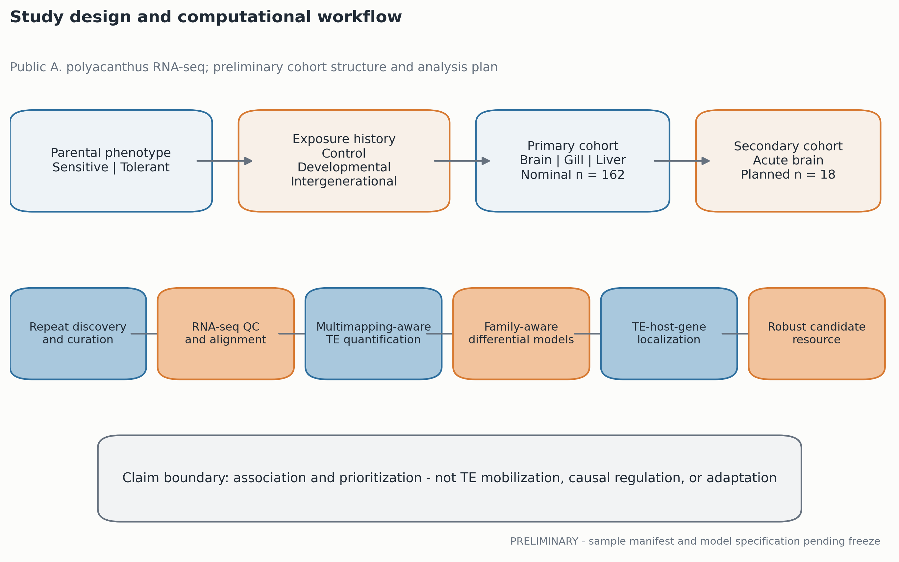
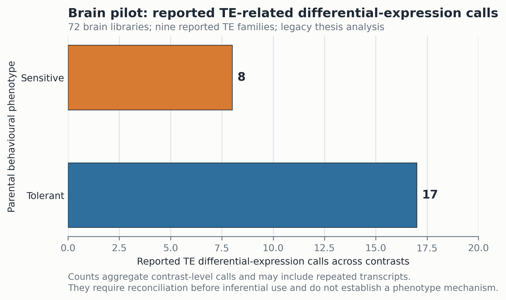
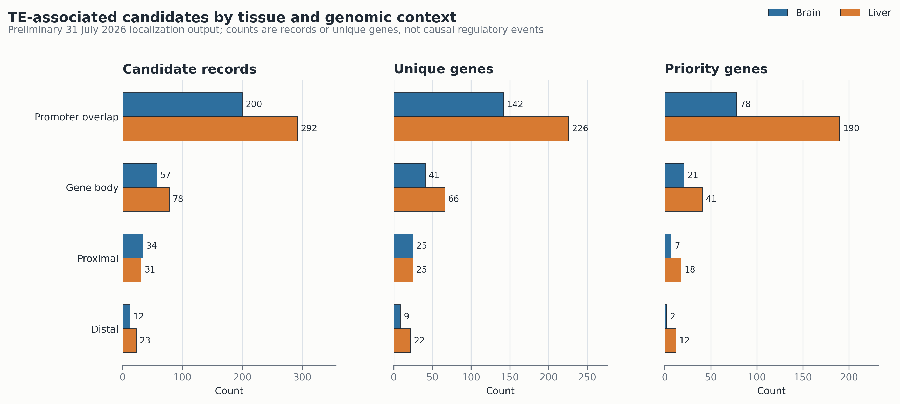

# Tissue-specific transposable-element and host-gene responses across developmental and intergenerational ocean-acidification exposures in a coral reef fish

**First computational manuscript draft - preliminary results**

**Authors:** Kaisar Dauyey et al. [complete author list and affiliations]

**Corresponding author:** [name, institution, email]

> **Draft status:** This manuscript integrates the study protocol, the TE-focused
> analysis reported in Dauyey's PhD thesis, and preliminary outputs generated on
> 31 July 2026. All numerical results must be reconciled against frozen,
> versioned result tables before submission. Bracketed text marks required
> author decisions or analyses.

## Abstract

Ocean acidification can alter the physiology, behaviour, and transcriptional
state of marine fishes, but the contribution of repetitive genomic elements to
these responses remains poorly resolved. Transposable elements (TEs) are a
substantial component of vertebrate genomes and can be transcribed in
developmental and environmental-stress contexts. However, conventional
gene-centred RNA-sequencing analyses often underrepresent repetitive
transcripts, particularly in non-model species. Here, we reanalyse public
RNA-sequencing data from the spiny chromis, *Acanthochromis polyacanthus*, to
characterize TE-associated transcription across ocean-acidification exposure
histories and to prioritize TE-host-gene relationships for future study. The
study combines a species-specific repeat annotation, multimapping-aware TE
quantification, tissue-stratified differential analysis, and genomic
localization relative to differentially expressed host genes. Earlier analysis
of 72 juvenile brain transcriptomes identified treatment- and
parental-phenotype-associated expression among nine TE-related families, with
acute and developmental exposure patterns differing from control and
intergenerational groups. In the current preliminary localization analysis,
29,923 annotated genes and 743,008 stringently filtered TE instances were
integrated with 202,483 gene differential-expression records. Of these records,
5,184 met an absolute log2-fold-change threshold of 0.5, yielding 727
candidate gene-contrast records associated with nearby or overlapping TEs.
Promoter-overlapping candidates formed the largest context category, including
226 liver genes and 142 brain genes; 190 liver and 78 brain genes in this
category met the current priority-gene rules. Candidate locus maps highlighted
a liver association involving `LOC127531358` and
`rnd-5_family-4732/DNA`, and a brain association involving `sptbn5` and
`rnd-5_family-4070/DNA`. These preliminary results support a model in which
TE-associated transcription and genomic context add a tissue-dependent layer
to the host response to elevated CO2. They do not demonstrate TE mobilization
or causal regulation. The completed study will provide a reproducible
computational resource and a rigorously ranked set of TE-host-gene hypotheses
without requiring experimental validation for its defined associative claims.

**Keywords:** ocean acidification; transposable elements; coral reef fish;
RNA-seq; intergenerational exposure; transcriptomics; regulatory genomics;
*Acanthochromis polyacanthus*

## Introduction

### Ocean acidification and plastic responses in reef fishes

The uptake of anthropogenic carbon dioxide by seawater is altering ocean
carbonate chemistry and increasing concern about the capacity of marine
organisms to maintain physiological performance under future conditions.
Experimental exposure to elevated CO2 has been associated with changes in
olfaction, predator-cue responses, activity, and other behaviours in coral reef
fishes. These effects are variable among species, populations, families, and
individuals, indicating that environmental history and biological background
are important components of the response.

Developmental plasticity and parental exposure can alter molecular phenotypes
in offspring. In *A. polyacanthus*, previous experimental work linked elevated
CO2 exposure to brain transcriptional changes involving neuronal signalling,
ion regulation, and gamma-aminobutyric acid (GABA)-related processes (Schunter
et al., 2016, 2018). The source experiment classified parental fish according
to their behavioural response to conspecific alarm cues and generated offspring
under control, acute, developmental, and parental-plus-offspring elevated-CO2
conditions. This design provides an opportunity to examine how exposure timing
and parental phenotype relate to offspring molecular responses. Because both
parents and offspring are involved in one treatment, we use
"intergenerational" rather than "transgenerational" for biological
interpretation unless a strict inheritance claim is explicitly supported.

### Transposable elements as an underexamined transcriptomic layer

TEs include diverse DNA transposons and retrotransposons that have proliferated
within host genomes. Their evolutionary effects range from insertional mutation
to the donation of promoters, enhancers, splice sites, and other regulatory
sequences. TE-derived RNAs and TE-associated regulatory sequences have been
linked to development, stress responses, and lineage-specific gene regulation
(Bourque et al., 2018; Almeida et al., 2022). Examples in vertebrate nervous
systems further suggest that TE-derived sequence can contribute to
cell-type-specific regulatory architecture. These observations make TEs
plausible participants in environmentally responsive transcription, but they
do not imply that every expressed TE is mobile or functional.

TE analysis from short-read RNA sequencing is technically difficult. Reads may
map to multiple homologous copies, a transcript annotated as TE-related may
represent a domesticated host gene, and signal assigned to a TE locus may arise
from an overlapping gene or read-through transcription. These problems are
especially important in non-model fishes, where repeat libraries and gene
annotations remain incomplete. Species-specific repeat discovery,
multimapping-aware quantification, locus-level inspection, and sensitivity
analyses are therefore required to distinguish reproducible signal from
annotation or mapping artefact.

### Previous brain-focused analysis and the present extension

Dauyey (2024) performed an initial computational analysis of 72 public juvenile
brain transcriptomes from *A. polyacanthus*. That work reported TE-related
differential expression across acute, developmental, intergenerational, and
control exposures and described treatment-dependent patterns involving Pogo-,
PiggyBac-, LINE-1-, and TX1-related transcripts. It also reproduced broad
gene-expression and functional patterns involving neural signalling and GABA
receptor biology. The thesis analysis established feasibility and generated
biological hypotheses, but it relied on a handcrafted set of 583 TE-related
annotations and conventional short-read counting. It therefore motivates a
more comprehensive, species-specific and explicitly robustness-focused
analysis.

The present study extends that foundation in three ways. First, it uses a de
novo repeat annotation to describe a broader TE landscape. Second, it expands
the biological scope from the brain-focused pilot toward tissue-resolved
analysis of brain, gill, and liver in the primary public cohort. Third, it
integrates TE locations with host-gene differential-expression results to
prioritize promoter-overlapping, gene-body, proximal, and distal associations.
This integration is intended to generate testable regulatory hypotheses, not
to infer causal regulation from proximity alone.

### Study questions

We asked: (1) what TE diversity is represented in the *A. polyacanthus*
reference genome under a species-specific annotation; (2) whether TE-derived
expression differs by tissue and elevated-CO2 exposure history; (3) whether
responses differ between offspring of sensitive and tolerant parental
phenotypes after accounting for family structure; (4) which signals remain
stable across mapping, annotation, and statistical sensitivity analyses; and
(5) which supported TE loci are associated with nearby or overlapping
host-gene responses. We expected tissue to be a major source of variation but
did not prespecify a required direction for any exposure contrast.

> **FIGURE 1 HERE - Experimental design and computational workflow.** Show the
> public cohorts, tissue-by-exposure-by-parental-phenotype structure, family
> lines, the separate acute-brain cohort, and the progression from repeat
> discovery to TE quantification, differential modelling, localization, and
> candidate prioritization.

## Results

### Public-data reconstruction defines the primary and secondary cohorts

The planned primary cohort comprises 162 libraries spanning brain, gill, and
liver; control, developmental elevated-CO2, and intergenerational elevated-CO2
conditions; and sensitive or tolerant parental behavioural phenotypes. The
nominal design contains nine libraries in each tissue-by-exposure-by-phenotype
cell. An additional 18 acute-exposure brain libraries are available within
BioProject PRJNA311159 and will be analysed as a separate temporal comparison
after metadata reconciliation. [Replace planned counts with the frozen
accession manifest, report all exclusions, and state whether individual fish or
family lines are repeated across tissues.]

The earlier thesis analysis included 72 brain libraries, with nine offspring
per exposure-by-parental-phenotype group across control, acute,
developmental, and intergenerational conditions. Parental fish were assigned
to sensitive and tolerant behavioural groups using their response to
conspecific alarm cues. Offspring were sampled at approximately five months,
and the acute group experienced elevated CO2 for four days before collection.
The control and elevated-CO2 conditions were reported as approximately 414 and
754 micro-atmospheres pCO2, respectively (Dauyey, 2024; verify against the
source metadata before final wording).

> **TABLE 1 HERE - Cohort composition, accession provenance, family lines,
> sequencing batches, and exclusions.** This table is essential for a
> validation-independent paper because it makes the experimental unit and
> possible confounding visible.

### A species-specific annotation yields a large set of TE instances

The preliminary localization workflow intersected 743,008 stringently filtered
TE instances with an annotation containing 29,923 genes. [Insert final genome
assembly, RepeatModeler/RepeatMasker versions, library checksum, TE genomic
coverage, and counts by class and family.] The current result establishes a
substantially broader search space than the 583 TE-related records used in the
brain-focused thesis analysis. However, the 743,008-instance total is a
computational annotation count and should not be interpreted as the number of
active or intact mobile elements.

The final repeat landscape will summarize DNA transposons, LTR
retrotransposons, LINEs, SINEs, rolling-circle elements, and unclassified
repeats. Automated `Unknown` assignments will remain unclassified unless
supported by sequence homology, structural features, or manual curation.

> **FIGURE 2 HERE - Species-specific repeat landscape.** Use a stacked bar or
> sunburst for genomic coverage and locus counts by TE class, plus a genomic
> context panel showing promoter, gene-body, proximal, distal, and intergenic
> distributions. Avoid a decorative genome plot unless it answers a specific
> question.

> **TABLE 2 HERE - Repeat-annotation summary.** Include class, family count,
> locus count, covered base pairs, genome percentage, expressed-family count,
> and confidence/curation status.

### The brain pilot identifies exposure-associated TE-related transcripts

In the thesis analysis, global expression structure among 72 brain samples was
assessed with correlation, hierarchical clustering, and principal-component
analysis. The first two principal components explained 20% and 19% of the
reported variance, respectively. The thesis interpreted the dominant structure
as being associated with parental phenotype and treatment, although this
interpretation requires re-evaluation with family and batch variables displayed
simultaneously.

Gene-level contrasts produced widely varying numbers of differentially
expressed transcripts. The largest reported contrasts included 6,501 genes for
control versus acute exposure in offspring of tolerant parents, 928 for the
corresponding sensitive-parent comparison, 3,829 for a developmental-versus-
control comparison, and 2,320 for a transgenerational comparison [restore exact
contrast labels from the archived result tables]. These results demonstrate a
large transcriptional response but should not be compared solely by DEG count,
because model design, dispersion, power, and effect-size distributions may
differ among contrasts.

The thesis reported TE-related differential expression involving nine TE
families. Across comparisons restricted to offspring of tolerant parents, 17
TE-related differentially expressed transcript calls were reported, compared
with eight among offspring of sensitive parents. Pogo-related transcripts,
PiggyBac-derived proteins, LINE-1 ORF1-related signal, TX1, and putative
transposase-related records contributed to the observed patterns. Acute and
developmental groups showed higher expression of selected LINE-1- and
PiggyBac-related records, whereas selected Pogo-, TX1-, and PiggyBac-derived
records were prominent in control and intergenerational groups. These legacy
results are hypothesis-generating because transcript identity, family
membership, duplicated calls across contrasts, and mapping specificity still
require audit under the new annotation.

> **FIGURE 3 HERE - Reanalysis of the 72-sample brain pilot.** Combine a PCA
> labelled by treatment, parental phenotype, family, and batch with an effect-
> size heatmap for the audited TE families. Do not reuse a heatmap of
> significance counts without showing effect direction and uncertainty.

### Preliminary TE-host-gene integration prioritizes promoter-overlapping associations

The current localization analysis integrated 202,483 host-gene
differential-expression records with the TE annotation. A total of 5,184
gene-contrast records passed the provisional absolute log2-fold-change threshold
of 0.5, and 727 records entered the TE-associated candidate set. These values
describe rows at defined stages of the workflow and are not counts of unique
causal genes or regulatory events.

Promoter overlap was the largest candidate context in both tissues represented
in the preliminary output. In liver, the analysis identified 292
promoter-overlap gene-contrast records representing 226 genes, of which 190
met the current priority-gene rules. The liver output additionally contained
78 gene-body records (66 genes; 41 priority), 31 proximal records (25 genes; 18
priority), and 23 distal records (22 genes; 12 priority). In brain, the output
contained 200 promoter-overlap records (142 genes; 78 priority), 57 gene-body
records (41 genes; 21 priority), 34 proximal records (25 genes; seven priority),
and 12 distal records (nine genes; two priority).

| Tissue | TE context | Candidate records | Unique genes | Priority genes |
|---|---:|---:|---:|---:|
| Liver | Promoter overlap | 292 | 226 | 190 |
| Liver | Gene body | 78 | 66 | 41 |
| Liver | Proximal | 31 | 25 | 18 |
| Liver | Distal | 23 | 22 | 12 |
| Brain | Promoter overlap | 200 | 142 | 78 |
| Brain | Gene body | 57 | 41 | 21 |
| Brain | Proximal | 34 | 25 | 7 |
| Brain | Distal | 12 | 9 | 2 |

The predominance of promoter-overlapping records is compatible with a
regulatory hypothesis, but several non-causal explanations must first be
excluded. These include the greater probability of overlap in repeat-rich
promoters, shared annotation boundaries, transcription initiated from the host
gene, and ranking rules that may favour well-annotated differentially expressed
genes. The final analysis will therefore compare the observed distribution with
matched genomic backgrounds and report enrichment, not raw frequency alone.

> **FIGURE 4 HERE - Tissue-by-context candidate landscape.** Use proportional
> bars or a dot plot to compare candidate records, unique genes, and priority
> genes. Add confidence intervals from a matched-background enrichment test in
> the final version.

> **TABLE 3 HERE - Complete tissue and genomic-context summary.** Include gill
> after the full cohort is integrated, or state explicitly why gill is absent
> from this analysis module.

### Preliminary locus maps identify brain and liver candidates

The current ranking highlighted a liver association between
`LOC127531358` and the DNA-transposon family
`rnd-5_family-4732/DNA`, and a brain association between `sptbn5` and
`rnd-5_family-4070/DNA`. The latter gene encodes a spectrin-family protein and
is biologically compatible with a neural/cytoskeletal context, but biological
plausibility was not used as evidence of TE-mediated regulation. Both
candidates require confirmation of gene identity, TE family classification,
genomic coordinates, strand orientation, locus-specific read support,
differential-effect estimates, and stability across alternative annotations.

These candidates should be presented as examples of the ranking framework,
not as validated mechanisms. The final figure will display the TE and gene
coordinates, promoter or gene-body definition, per-sample expression, treatment
effect estimates, and read-level evidence where permitted by the short-read
data.

> **FIGURE 5 HERE - Representative candidate locus maps.** Panel A:
> `LOC127531358` - `rnd-5_family-4732/DNA` in liver. Panel B: `sptbn5` -
> `rnd-5_family-4070/DNA` in brain. Panel C: matched-sample TE and gene
> expression with family identities. Mark orientation, mapping uniqueness, and
> uncertainty directly on the figure.

> **TABLE 4 HERE - Ranked TE-host-gene candidates.** Required columns:
> tissue, exposure contrast, parental phenotype, family line, gene, TE family,
> coordinates, genomic context, distance, strand, TE effect size and FDR, gene
> effect size and FDR, adjusted association, mapping support, annotation
> sensitivity, and confidence tier.

### Functional interpretation remains provisional

The thesis gene-level enrichment analysis identified categories involving
GABA-A receptor activity, ion-channel function, synaptic signalling, and
neuronal membrane biology in selected brain contrasts. These findings are
consistent with previously reported neural responses to elevated CO2 in this
experimental system. The new TE-host-gene integration further prioritizes
liver stress, metabolic, and detoxification genes and brain neurotransmitter-
related genes. At present, these category labels represent prioritization
rules and preliminary enrichment context rather than evidence that the paired
TEs regulate the corresponding pathways.

The final enrichment analysis will use explicit tested-gene backgrounds,
separate tissues and contrasts, account for duplicated gene-contrast records,
and report all tested terms. Enrichment will be performed both for the complete
candidate set and for candidates that pass the mapping, annotation, and
family-line robustness filters.

> **FIGURE 6 HERE - Functional synthesis after robustness filtering.** Use a
> compact enrichment map or dot plot split by tissue and exposure pattern. The
> figure should distinguish all candidates from the high-confidence subset and
> show the tested background.

### Robustness analyses will define the final evidence set

The full study will compare multimapping-aware family estimates with
unique-read or stricter-mapping estimates, de novo with homology-supported
repeat annotation, and alternative reasonable expression filters. Leading
signals will be examined for dependence on one sample, one family line,
sequencing depth, mapping rate, or batch. Locus candidates will be assessed for
overlapping host transcripts, read-through, strand ambiguity, and local mapping
uniqueness. [Insert completed robustness results.]

> **FIGURE 7 HERE - Robustness matrix.** Rows should be leading TE families or
> loci and columns should be model, annotation, mapping, outlier, family-line,
> and locus-support checks. Display effect direction and confidence rather than
> a simple pass/fail traffic light.

## Discussion

### A TE-centred reanalysis extends the gene-centred view of OA response

The preliminary analyses indicate that TE-associated transcription and genomic
context can be recovered from public *A. polyacanthus* RNA-sequencing data and
organized into biologically interpretable, tissue-specific hypotheses. The
brain-focused thesis analysis identified a small group of TE-related transcripts
whose expression differed among exposure histories and parental-phenotype
groups. The new species-specific localization workflow broadens the candidate
space and shows that many differentially expressed host genes lie near or
overlap annotated TE instances. Together, these results support continued
analysis of TEs as an additional transcriptomic layer rather than as a dominant
explanation for the entire response.

The preliminary data also argue against reducing the OA response to one common
TE programme. In the brain pilot, acute and developmental exposure were
associated with different TE-related expression patterns from control and
intergenerational exposure. In the localization analysis, promoter-overlapping
candidate records were prominent in both brain and liver, but the prioritized
host-gene categories differed between neural and metabolic/detoxification
contexts. A tissue-stratified framework is therefore more defensible than an
organism-wide claim.

### Exposure history and parental phenotype require cautious interpretation

Differences between offspring of sensitive and tolerant parents are of
biological interest, but parental phenotype may be partially confounded with
family line and genetic background. The thesis reported more TE-related
differential-expression calls in tolerant-parent contrasts than in
sensitive-parent contrasts. This pattern should be retested with an estimable
family-aware model and displayed at the individual- and family-line levels.
Without independent families or replication, the results can support a
phenotype-associated pattern in this cohort but not a general genetic mechanism
of tolerance.

Likewise, similarity between the intergenerational and control groups does not
by itself demonstrate restoration, rescue, or adaptation. A return-toward-
control claim requires evidence that the developmental and intergenerational
effects differ and that the intergenerational-control contrast lies within a
prespecified equivalence interval. Fitness benefit is not measured by the
RNA-sequencing data.

### Promoter overlap provides hypotheses, not causal regulatory evidence

The excess of promoter-overlapping candidates in the preliminary results is a
potentially important observation. TE-derived sequences can contribute
cis-regulatory elements, and promoter-localized TEs are therefore plausible
sources of transcriptional modulation. However, overlap alone cannot establish
directionality or function. The observed pattern could be influenced by genome
annotation, repeat density, transcript structure, or the candidate-selection
procedure. Matched-background enrichment, orientation-aware locus inspection,
and adjusted TE-gene association are needed before promoter overlap is
interpreted as more than genomic colocalization.

The `LOC127531358` and `sptbn5` examples illustrate this distinction. They are
useful candidates because they combine tissue-specific host-gene relevance with
a nearby or overlapping TE annotation. They are not functionally validated,
and the current evidence does not show that either TE changes host-gene
expression. Their principal value is to anchor a transparent ranking and
visualization framework that can be tested with future long-read,
chromatin-accessibility, reporter, or perturbation studies.

### Analytical validation can support publication without wet-lab experiments

This study is designed so that its central claims are computational and can be
evaluated directly from public data. Cohort reconciliation, species-specific
annotation, explicit statistical contrasts, family-aware modelling,
multimapping sensitivity, locus-level inspection, negative or null results,
and complete provenance provide analytical validation for claims about
association and prioritization. These procedures do not replace functional
experiments; rather, they define a different and appropriately limited class of
claim.

Publication without wet-lab validation is defensible if all major conclusions
are traceable to versioned evidence, leading signals remain stable across key
analytical choices, and the manuscript consistently avoids causal language.
The resulting repeat resource, full contrast tables, and ranked TE-host-gene
catalogue can themselves constitute a useful contribution to environmental and
comparative genomics.

### Limitations

Several limitations shape interpretation. First, this is a secondary analysis
of public short-read RNA sequencing. Library preparation may omit or distort
some TE-derived transcripts, and short reads cannot resolve all repetitive
loci. Second, multimapping-aware estimates improve family-level recovery but
do not guarantee locus specificity. Third, TE-related protein annotations may
represent domesticated host genes rather than autonomous elements. Fourth,
family structure may limit separation of parental phenotype from genetic
background. Fifth, genomic proximity and correlated expression do not
demonstrate TE-mediated regulation. Sixth, TE RNA is not evidence of new
insertion or mobilization. Seventh, exposure across parents and offspring is
intergenerational; the study does not establish strict transgenerational
inheritance. Finally, the current numerical results are preliminary until the
complete manifest, gill integration, model outputs, and sensitivity analyses
are frozen.

### Conclusion

The preliminary data support a comprehensive computational study of TE
responses to elevated CO2 in *A. polyacanthus*. A brain-focused pilot identified
exposure-associated TE-related transcripts, while a broader species-specific
localization analysis identified hundreds of TE-associated host-gene candidate
records, especially in promoter-overlapping contexts in brain and liver. The
completed analysis will determine which patterns survive family-aware,
mapping, annotation, and locus-level sensitivity tests. Framed as a
reproducible study of association and hypothesis prioritization, the work can
make a publishable contribution without experimental validation while creating
a rigorous foundation for future mechanistic studies.

## Methods

### Study design and public datasets

The study reanalyses RNA-sequencing data from juvenile *A. polyacanthus*
generated in experimental elevated-CO2 studies. The planned primary cohort
contains 162 libraries from brain, gill, and liver under control,
developmental, and intergenerational exposure histories and two parental
behavioural phenotypes. The separate acute-brain comparison contains 18
additional libraries within BioProject PRJNA311159, subject to final metadata
verification. Brain RNA-sequencing data are associated with PRJNA311159; gill
and liver data are associated with PRJNA989422. [Insert frozen accession table,
BioSample identifiers, source-paper supplementary-table version, and data
retrieval dates.]

### Metadata reconciliation and cohort eligibility

Run accessions will be matched to BioSample, individual fish, tissue, parental
phenotype, family, offspring exposure, parental exposure, sequencing project,
instrument, and processing batch. Runs will enter the primary analysis only
after reconciliation with the source metadata. Technical exclusions will use
predefined criteria and will be documented; principal-component position alone
will not be sufficient for exclusion. Influential-sample analyses will be
reported where feasible.

### Reference genome and repeat annotation

All analyses will use one frozen *A. polyacanthus* genome assembly and matching
gene annotation [insert accession and release]. Repeats will be discovered with
RepeatModeler2 and annotated with RepeatMasker [insert versions, databases,
parameters, and checksums]. Automated classifications will be curated with
particular attention to expressed and differential families. Repeat classes,
families, loci, genomic coverage, divergence, and classification uncertainty
will be summarized. A homology-supported library will provide an annotation
sensitivity analysis where available.

### RNA-sequencing processing and quality control

FASTQ checksums, adapter content, base quality, duplication, read length, and
library strandedness will be assessed. Reads will be aligned to the frozen
reference with STAR while retaining multimapping alignments needed for TE
quantification. MultiQC summaries will include total, unique, multimapping,
unmapped, and assigned-read fractions. All tissues will use the same reference
and annotation versions. [Insert exact software versions and parameters.]

The legacy thesis analysis aligned paired-end 100-bp brain reads to RefSeq
assembly GCF_021347895.1 with STAR, quantified a handcrafted combined gene/TE
GTF with HTSeq, and used DESeq2 for differential analysis. Those results are
treated as a pilot and will be re-evaluated with the frozen pipeline.

### TE and gene quantification

TE-family expression will be estimated with a multimapping-aware method
[planned TEcount; confirm final implementation]. Uniquely mapped counts and
alternative mapping filters will be retained for sensitivity analysis. Genes
will be quantified using the matching gene annotation. Locus-level
quantification will be performed only for preregistered leading candidates and
will include inspection of read orientation, transcript structure, overlap,
and local mappability.

### Differential-expression models

Models will be fit separately by tissue. Candidate designs include
`count ~ family + treatment` within parental phenotype and
`count ~ family + parental_phenotype * treatment` when the interaction is
estimable. If nesting or rank deficiency prevents these models, an alternative
mixed-model or pseudobulk strategy that preserves family-level structure will
be documented. Low-expression filtering will be defined before testing.
P-values will be adjusted using the Benjamini-Hochberg procedure within each
prespecified contrast family. Results will report shrunken log2 fold changes,
confidence intervals, and FDR values. The primary significance threshold is
FDR < 0.05; effect-size criteria will be frozen before narrative selection.

### Exposure-response classification

Within each tissue, developmental and intergenerational contrasts will be
classified as persistent, developmental-specific, return-toward-control, or
intergenerational-specific using the prespecified rules in the study protocol.
A return-toward-control classification will require developmental-control and
developmental-intergenerational evidence plus an intergenerational-control
estimate within a predefined equivalence interval. A nonsignificant contrast
alone will not be treated as equivalence.

### TE-host-gene integration

Supported TE loci will be intersected with gene annotations and classified as
promoter overlap, gene body, proximal, distal, or intergenic according to
frozen coordinate definitions. Overlapping and nearest genes will be reported,
with prespecified 2-kb and 10-kb windows. TE-gene expression associations will
be estimated in matched samples while adjusting for treatment, parental
phenotype, family, and technical covariates where estimable. Enrichment of
genomic contexts will use matched background loci, and functional enrichment
will use an explicit tested-gene universe.

### Candidate ranking

Candidates will be ranked using frozen criteria that incorporate TE and gene
effect sizes, FDR, genomic context, adjusted expression association,
family-line consistency, mapping support, annotation confidence, and
sensitivity status. Biological interest or experimental convenience will not
override analytical evidence. Candidates that fail key robustness checks will
remain labelled exploratory.

### Reproducibility

Code, compact manifests, checksums, software environments, workflow versions,
figure source data, and eligible derived result tables will be versioned in the
private project repository during drafting and released according to the
target journal and data-governance plan at publication. Raw FASTQ, BAM, and
large intermediate files will remain in their authoritative public archives or
on compute storage and will not be committed to Git.

## Data availability

The public RNA-sequencing datasets are available from NCBI under BioProjects
PRJNA311159 and PRJNA989422. The reference genome accession, frozen sample
manifest, and all additional source identifiers will be provided in the final
version.

## Code availability

The analysis workflow is maintained at
<https://github.com/Kays3/TE_Ocean_Acidification>. The manuscript repository is
private during drafting. A versioned code and compact-result release will be
prepared before publication [insert archive DOI or release tag].

## Ethics statement

This study is a secondary analysis of previously generated, publicly archived
data and involved no new animal experiments. Original animal collection and
experimental approvals should be cited from the source studies [insert exact
approval identifiers and wording].

## Author contributions

[Complete using CRediT roles.]

## Competing interests

The authors declare [complete statement].

## Acknowledgements

[Complete funding, institutional, compute, and contributor acknowledgements.]

## References - working list

Almeida, M. V., Vernaz, G., Putman, A. L. K. & Miska, E. A. Taming
transposable elements in vertebrates: from epigenetic silencing to
domestication. *Trends in Genetics* **38**, 529-553 (2022).

Bourque, G. et al. Ten things you should know about transposable elements.
*Genome Biology* **19**, 199 (2018).

Dauyey, K. *Deciphering Intelligence in Ancient Humans and Adaptation in Coral
Reef Fish*. PhD thesis, The Graduate University for Advanced Studies, SOKENDAI
(2024).

Dobin, A. et al. STAR: ultrafast universal RNA-seq aligner. *Bioinformatics*
**29**, 15-21 (2013).

Love, M. I., Huber, W. & Anders, S. Moderated estimation of fold change and
dispersion for RNA-seq data with DESeq2. *Genome Biology* **15**, 550 (2014).

Schunter, C. et al. Molecular signatures of transgenerational response to ocean
acidification in a species of reef fish. *Nature Climate Change* **6**,
1014-1018 (2016).

Schunter, C. et al. An interplay between plasticity and parental phenotype
determines impacts of ocean acidification on a reef fish. *Nature Ecology &
Evolution* **2**, 334-342 (2018).

Suresh, S. et al. [Insert verified title and complete bibliographic details].
*Communications Biology* **7**, 1531 (2024).
<https://doi.org/10.1038/s42003-024-07241-y>

> **Reference audit required:** Import the complete source-paper bibliography,
> verify every metadata value against primary sources, remove uncited working
> references, and format to the selected journal style before submission.
